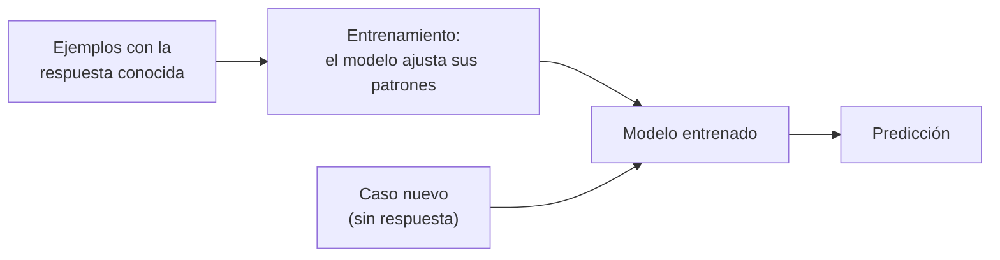
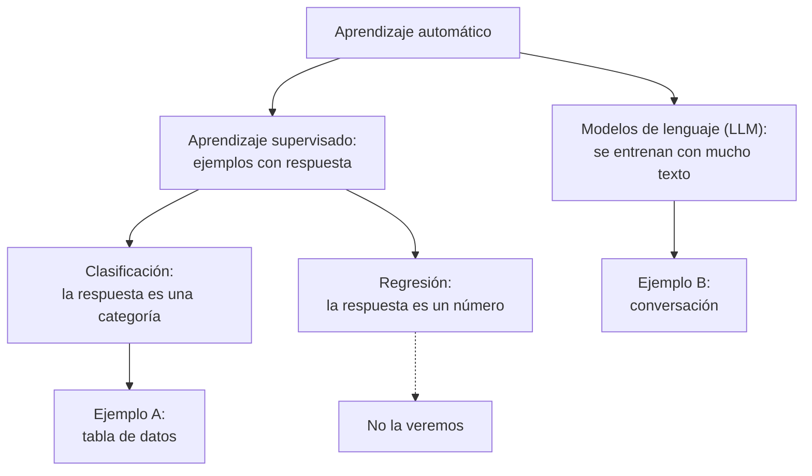

# Guía de ejercicios de DashAI: clasificación con una tabla y conversación con un modelo de lenguaje

[Pablo Badilla](https://github.com/pbadillatorrealba)\
Tech Lead Oficina de Proyectos\
[Iniciativa de Datos e Inteligencia Artificial](https://idia.uchile.cl/)\
[Facultad de Ciencias Físicas y Matemáticas](https://ingenieria.uchile.cl/)\
[Universidad de Chile](https://uchile.cl/)

**Lo que necesitas:** DashAI funcionando en [Colab](https://colab.research.google.com/github/idia-tt/jornadas_hcuch_tutorial_dashai/blob/main/DashAI_Colab.ipynb) o en [tu computador](docs/dashai-local.md), y un navegador. Cada ejemplo toma unos 20 minutos.

También puedes [preparar DashAI en tu computador](docs/dashai-local.md). En modo local, genera `breast_cancer.csv` con `uv run python scripts/generar_datos.py` y abre `http://127.0.0.1:8000/app/`. Las referencias a preparación y descarga en Colab solo aplican a esa alternativa. Para apagar localmente usa Ctrl+C; tus sesiones permanecen en `.dashai`.

**Contenido**

1. [¿Qué es DashAI?](#s1)
2. [Aprendizaje automático, en simple](#s2)
3. [Ejemplo A: clasificación con una tabla](#s3)
4. [Ejemplo B: generación de texto con un modelo de lenguaje](#s4)
5. [Si algo no funciona](#s5)
6. [Glosario](#s6)
7. [Para seguir aprendiendo](#s7)

## 1. ¿Qué es DashAI?

[DashAI](https://dash-ai.com/) es un programa con interfaz gráfica para entrenar, evaluar y usar modelos de aprendizaje automático haciendo clic, sin escribir código. Lo dejaremos funcionando dentro de Google Colab y lo veremos dentro del propio cuaderno de Colab. Puedes consultar su [documentación](https://docs.dash-ai.com/) y su [código](https://github.com/DashAISoftware/DashAI).

> **Antes de empezar**\
> Abre el cuaderno de Colab y sigue la sección 2 (Preparación) hasta ver DashAI en el recuadro del Paso 4. Después vuelve aquí. Conviene tener esta guía y el cuaderno lado a lado.

## 2. Aprendizaje automático, en simple

En un programa tradicional, una persona escribe las reglas. En el aprendizaje automático se hace al revés: se le dan al computador muchos ejemplos y él busca por sí mismo los patrones que mejor los explican. El resultado de esa búsqueda se llama **modelo**.

### Aprendizaje supervisado

Es el caso en que los ejemplos vienen con la respuesta correcta. Imagina una tabla con una fila por persona, varias columnas con sus características y una última columna con el resultado que nos interesa. El modelo revisa muchas filas y aprende qué patrones se asocian a cada resultado. Después se le muestra una fila nueva, sin el resultado, y propone uno. Puede equivocarse.

Hay tres palabras que se repiten mucho:

- **Entrenar:** dejar que el modelo ajuste sus patrones con los ejemplos.
- **Evaluar:** probarlo con filas que no se usaron para ajustarlo, como un examen con preguntas distintas a las que se estudiaron. Para eso, antes de entrenar, los datos se reparten en tres grupos: *entrenamiento* (con el que aprende), *validación* (con el que se comparan variantes del modelo) y *prueba* (el examen final).
- **Predecir:** usarlo con casos nuevos.

### Clasificación

Es un tipo de aprendizaje supervisado donde la respuesta es una **categoría**: "sí / no", "tipo A / B / C", "riesgo alto / medio / bajo". Cuando la respuesta es un número (una edad, un valor de laboratorio) se habla de regresión, que no veremos aquí.

### Modelos de lenguaje (LLM)

Un modelo de lenguaje, como el que está detrás de ChatGPT, funciona de otra manera. Se entrena con enormes cantidades de texto para predecir qué fragmento de palabra viene a continuación y después se ajusta para seguir instrucciones. Así puede responder, resumir o redactar, y también sonar convincente sin tener razón. No lo vamos a entrenar: usaremos uno pequeño que ya viene entrenado y conversaremos con él.

## 3. Ejemplo A: clasificación con una tabla

Usaremos el dataset **Breast Cancer Wisconsin**, uno de los ejemplos clásicos de la biblioteca [scikit-learn](https://scikit-learn.org/) ([documentación del dataset](https://scikit-learn.org/stable/modules/generated/sklearn.datasets.load_breast_cancer.html)): 569 filas, una por cada tumor de mama analizado. Cada fila tiene 30 columnas numéricas con medidas del núcleo de las células (radio, textura, perímetro, área, etc.), calculadas a partir de una imagen de una muestra tomada con una aguja delgada. La última columna, **diagnosis**, tiene dos categorías, *malignant* (maligno) y *benign* (benigno), y es la que el modelo intentará predecir.

> **Es solo un ejercicio**\
> Los datos son reales, pero este ejemplo es para aprender cómo funciona la clasificación. Los modelos que entrenes aquí no sirven para diagnosticar a nadie.

Este dataset no viene incluido en DashAI, así que primero lo generaremos en Colab, lo descargaremos en tu computador y lo subiremos a DashAI.

Si la pantalla de DashAI aparece en inglés, busca el selector de idioma (arriba a la derecha) y elige **Español**: los nombres de botones que usamos aquí vienen de esa versión. Algunas etiquetas, como *Input Columns* y los nombres de las métricas (*Accuracy*, *Recall*), aparecen en inglés aunque elijas español.

### A.1 Obtener y subir el conjunto de datos

En el cuaderno de Colab, ejecuta la celda del **Paso 5** (sección 3). Genera el archivo `breast_cancer.csv` y el navegador lo descarga a tu computador. Después, en el recuadro de DashAI:

1. En el menú superior, haz clic en **Datasets** y luego en la tarjeta **Dataset** ("Importa tus datos desde varias fuentes y formatos").
2. Elige **Cargador de Datos CSV** (en inglés, *dataloader*: la parte de DashAI que sabe leer cada tipo de archivo) y haz clic en **Siguiente**.
3. Escribe `breast_cancer` en **Nombre del Dataset**, haz clic en **Subir un archivo** (o arrastra el archivo) y elige `breast_cancer.csv`. Espera a que aparezca la vista previa.
4. Haz clic en **Subir**.
5. Al terminar, DashAI abre el dataset: 569 filas, 31 columnas, un resumen de calidad y la vista previa. Si aparece un tutorial, ciérralo con **Saltar tutorial**.

### A.2 Explorar los datos (opcional)

Antes de entrenar conviene mirar los datos. Las 30 columnas son 10 medidas del núcleo celular (radio, textura, perímetro, área, suavidad, compacidad, concavidad, puntos cóncavos, simetría y dimensión fractal), cada una en tres versiones: promedio (`mean`), error estándar (`error`) y peor valor (`worst`, el promedio de los tres valores más grandes). La pregunta es: ¿se distinguen los tumores malignos de los benignos por su radio?

1. En la página del dataset, haz clic en **Nuevo cuaderno**. (Aquí "cuaderno" es el espacio de análisis de DashAI; no es el cuaderno de Colab.) Verifica que el dataset elegido sea `breast_cancer`, ponle un nombre, por ejemplo `exploracion-breast-cancer`, y haz clic en **Crear cuaderno**.
2. En el panel **Herramientas de Análisis**, a la derecha, pestaña **Explorar**, haz clic en **Histograma** (está en el grupo *Análisis de Distribución*).
3. En el paso 1, *Configurar Alcance*, marca la fila `mean radius` y haz clic en **Siguiente**.
4. En el paso 2, *Configurar Parámetros*:
   - En **Normalización**, elige **Porcentaje**. El campo es obligatorio y la opción *Cuenta* no deja continuar.
   - En **Columna para grupo de color**, elige **String** y escribe `diagnosis`.
5. Haz clic en **Crear explorador**.

Verás un histograma de `mean radius` con un color para cada diagnóstico (la leyenda dice cuál es cuál). Los tumores benignos se concentran en radios pequeños y los malignos se desplazan hacia radios grandes. Esa diferencia es la que un modelo puede aprovechar para separarlos. En la zona intermedia los dos grupos se mezclan, y ahí es donde suele equivocarse más. Si quieres, repite con otras columnas, como `worst area` o `mean fractal dimension`, y compara cuáles separan mejor.

### A.3 Crear una sesión de entrenamiento

(Aquí "sesión" es el espacio de trabajo de DashAI para un problema; no tiene que ver con la sesión de Colab.)

1. En el menú superior, haz clic en **Modelos** y, en las tarjetas de tareas, en **Clasificación Tabular**.
2. Escribe un nombre en **Nombre de la Sesión**, por ejemplo `prueba-breast-cancer`, y en **Seleccionar un dataset** elige `breast_cancer`.
3. Revisa las columnas. **Input Columns** son las características que el modelo mirará (las 30 medidas) y **Output Columns** es la que queremos predecir (`diagnosis`). DashAI las propone automáticamente: revisa que sean esas.
4. En el panel de la derecha, *Configurar Sesión*, deja la estrategia **Holdout** con partición **Aleatorio**. Así los datos se reparten en 60 % para entrenamiento, 20 % para validación y 20 % para prueba.
5. Si el aviso de las columnas sale en verde, haz clic en **Crear sesión**. Si sale en rojo, lee el mensaje: casi siempre falta elegir una columna de entrada o de salida.

### A.4 Entrenar modelos

Vamos a comparar tres modelos. Los nombres en negrita son los que se usan en la literatura; en DashAI los verás en español, que es el que va entre paréntesis:

- **Dummy Classifier** (*Clasificador Dummy*): no usa las medidas de cada caso y responde siempre la categoría más frecuente. En este dataset, 357 de 569 casos son *benign*, así que acierta cerca de un 63 % sin aprender nada. Sirve como punto de comparación: un modelo que valga la pena tiene que superarlo.
- **Logistic Regression** (*Regresión Logística*): a pesar del nombre, clasifica. Combina las medidas con un peso para cada una y calcula qué tan probable es cada categoría, trazando una frontera simple entre las dos. Es rápido y fácil de explicar.
- **Random Forest** (*Bosque Aleatorio*): crea muchos árboles de decisión, cada uno con una serie de preguntas del tipo "¿el radio es mayor que 15?", y deja que voten. Capta relaciones más complejas, pero es más difícil de explicar.

1. Dentro de la sesión, en el panel **Modelos Disponibles** de la derecha, haz clic en **Clasificador Dummy**. En la ventana *Agregar Modelo a la Sesión*, deja el nombre propuesto y haz clic en **Agregar Modelo**.
2. Repite con **Regresión Logística** y **Bosque Aleatorio**. Si DashAI abre la página del modelo recién agregado, vuelve a la sesión desde la ruta de arriba (*Modelos / prueba-breast-cancer*).
3. En la sesión, haz clic en **Ejecutar todo**. Con estos modelos y 569 filas termina en pocos segundos.

### A.5 Ver resultados

1. En la misma sesión, baja hasta **Comparación de Modelos**. Tiene tres pestañas: **Entrenamiento**, **Validación** y **Prueba**. Elige **Prueba**: son filas que el modelo nunca vio.
2. Busca la columna **Accuracy** (exactitud), que es el porcentaje de casos bien clasificados, y compara los modelos. La estrella (★) marca el mejor valor de cada columna. Con este dataset, la Regresión Logística y el Bosque Aleatorio suelen acertar entre un 93 % y un 98 % en prueba, muy por encima del Dummy (cerca de 63 %). Si tu resultado está lejos de eso, revisa que la columna de salida sea `diagnosis`.
3. Con pocas filas, esta cifra cambia según cómo se repartan los datos. Si tus números difieren de los de otra persona, es normal.
4. Si un modelo sale muy bien en entrenamiento y bastante peor en prueba, es señal de que se ajustó demasiado a los ejemplos con que aprendió (se llama *sobreajuste*).
5. En un problema médico, no todos los errores pesan igual. Tomamos *malignant* como el resultado positivo, el que queremos detectar. Entonces el **error tipo I** (falso positivo) es decir "maligno" a un tumor benigno, y el **error tipo II** (falso negativo) es decir "benigno" a un tumor maligno, o sea, no detectarlo. Aquí el error tipo II es el más grave. Por eso, además de *Accuracy*, mira **Recall**: de todos los tumores malignos, qué fracción detectó el modelo. Equivale a 1 menos la tasa de error tipo II. El Dummy tiene 0, porque nunca responde *malignant* y comete error tipo II con todos los malignos.

### A.6 Hacer una predicción

1. Haz clic en uno de los modelos de la sesión, por ejemplo **Regresión Logística**, y luego en la pestaña **Predicciones** y en **Predicciones Manuales**.
2. Haz clic en **Agregar fila**. DashAI agrega una fila ya llena con los valores de un caso del dataset. Puedes cambiar cualquier valor haciendo clic en su celda; desplázate a la derecha para ver las 30 columnas.
3. Haz clic en **Ejecutar predicción**. Aparece el aviso "Predicción completada exitosamente".
4. Para leer el resultado, mira la última columna, **diagnosis**, marcada como *Predicción*. Muestra la categoría que el modelo eligió, `malignant` o `benign`. Es la categoría que el modelo estima, no un hecho: puede equivocarse, y esta tabla no muestra qué tan seguro está.
5. Para probar otro caso, agrega otra fila. Si quieres que la predicción cambie, modifica varios valores a la vez (por ejemplo, el radio, el perímetro y el área juntos): cambiar una sola columna rara vez basta.

### A.7 Qué te llevas y qué sigue

Con este ejercicio practicaste cuatro ideas que sirven en la mayoría de los problemas de clasificación:

- **Mirar los datos antes de entrenar**, para saber si hay algo que aprender (A.2).
- **Comparar el modelo con una base simple**, como el Dummy Classifier, para saber si un modelo aporta algo.
- **Evaluar con datos que el modelo no vio**, es decir, mirar la pestaña *Prueba* y no la de *Entrenamiento*.
- **Pensar qué error pesa más**: aquí, el error tipo II (no detectar un tumor maligno).

Para seguir practicando, agrega otros modelos de la lista, como **Decision Tree** (*Árbol de Decisión*), **K-Nearest Neighbors (KNN)** (*K-Vecinos más Cercanos*) o **Support Vector Machine (SVM)** (*Máquina de Vectores de Soporte*), y ve si alguno supera a la Regresión Logística y al Bosque Aleatorio. Si algo sale mal, crea otra sesión y vuelve a intentarlo.

Fuente de los datos: Wolberg, W. H., Street, W. N. y Mangasarian, O. L. *Breast Cancer Wisconsin (Diagnostic)*, UCI Machine Learning Repository, <https://archive.ics.uci.edu/dataset/17/breast+cancer+wisconsin+diagnostic>. La copia que usamos es la que incluye scikit-learn.

## 4. Ejemplo B: generación de texto con un modelo de lenguaje

Aquí conversaremos con un modelo de lenguaje. La primera vez, DashAI debe descargarlo desde internet.

### Qué es Text to Text

En DashAI, **Text to Text** (*Texto a Texto*) es la tarea en que el modelo recibe un texto y responde con otro texto. El texto de entrada es tu mensaje, que puede incluir un documento pegado, y la respuesta puede ser un resumen, una reescritura, una traducción o la respuesta a una pregunta. No es clasificación: no hay categorías fijas, porque el modelo escribe la respuesta pieza por pieza (cada pieza es un *token*). A este tipo de modelos se les llama *generativos*.

### B.1 Crear la sesión

1. En el menú superior, haz clic en **Generativo** y luego en la tarjeta **Crear una nueva sesión**.
2. En *Seleccionar Modelo*, filtra por **Texto a Texto (12)** y haz clic en el modelo que quieras usar. El número del nombre (1.5B) indica cuántos parámetros tiene el modelo, es decir, cuántas cifras ajustó al entrenarse: 1.500 millones. Mientras más grande, mejor responde pero más pesa.
   - **Qwen2.5 1.5B Instruct** ([ficha del modelo](https://huggingface.co/Qwen/Qwen2.5-1.5B-Instruct), 1,8 GB): el recomendado para los ejercicios de abajo. Responde bien en español y funciona también sin GPU, aunque más lento (un minuto o más por respuesta larga).
   - **SmolLM2 360M Instruct** ([ficha del modelo](https://huggingface.co/HuggingFaceTB/SmolLM2-360M-Instruct), 369 MB): el más liviano. Sirve para probar el flujo, pero en español se equivoca con frecuencia, mezcla idiomas e inventa datos.
3. Haz clic en el botón con el tamaño del modelo (por ejemplo, **1.8 GB**) para descargarlo. La tarjeta dirá *Descargando…* y puede demorar unos minutos. Cuando termine, se habilita **Siguiente**.
4. Haz clic en **Siguiente** y luego en **Crear una sesión**.

### B.2 Ajustar los parámetros

En el panel **Parámetros del Modelo**, a la derecha, cambia estos dos valores y haz clic en **Actualizar**. DashAI no conserva los valores que fijas al crear la sesión, así que cámbialos aquí, ya dentro de ella:

- **Tokens máximos**: el largo máximo de cada respuesta. Viene en 100, que es poco. Pon 400. Un token es un fragmento de palabra: en español, 1 token equivale a algo más de media palabra.
- **Ventana de contexto**: el límite total de tokens, contando tu mensaje, el historial de la conversación y la respuesta. Viene en 512, y un documento de 400 palabras no cabe. Pon 8192.

### B.3 Conversar

1. Cuando el modelo esté listo, escribe en el chat. Por ejemplo, puedes copiar y pegar este mensaje:

   `Explica con palabras simples qué es el aprendizaje automático.`
2. **Resumir un documento.** Abre esta noticia de [Radio Bío Bío](https://www.biobiochile.cl/), copia el título y el texto. En el chat, escribe esta instrucción y, debajo, pega la noticia:

   `Resume en 3 o 4 frases, en español, la siguiente noticia:`

   - [Un telescopio en Chile descubrió que el cometa interestelar 3I/ATLAS sería más antiguo que el Sol](https://www.biobiochile.cl/noticias/ciencia-y-tecnologia/astronomia/2026/07/06/un-telescopio-en-chile-descubrio-que-el-cometa-interestelar-3i-atlas-seria-mas-antiguo-que-el-sol.shtml) (6 de julio de 2026).
3. **Sintetizar varios documentos.** Abre estas tres noticias sobre el mismo cometa, copia el texto de cada una y pégalas en un solo mensaje, escribiendo "Noticia 1:", "Noticia 2:" y "Noticia 3:" antes de cada una. Al principio, escribe:

   `Lee estas tres noticias sobre el mismo tema y escribe una síntesis en un solo párrafo, en español: qué tienen en común y qué aporta cada una.`

   - [Descubren desde Chile un sorprendente detalle del cometa 3I/ATLAS](https://www.biobiochile.cl/noticias/ciencia-y-tecnologia/astronomia/2025/09/12/descubren-desde-chile-un-sorprendente-detalle-del-cometa-3i-atlas-es-diferente-a-cualquier-otro.shtml) (12 de septiembre de 2025).
   - [Descubren desde Chile prometedoras pistas sobre cómo se formó el cometa interestelar 3I/ATLAS](https://www.biobiochile.cl/noticias/ciencia-y-tecnologia/astronomia/2026/04/23/descubren-desde-chile-prometedoras-pistas-sobre-como-se-formo-el-cometa-interestelar-3i-atlas.shtml) (23 de abril de 2026).
   - La noticia del punto anterior (6 de julio de 2026).
4. Prueba otras tareas: reescribir un texto para que sea más claro o proponer un título.
5. Antes de confiar en la respuesta:

   - El modelo no abre enlaces: hay que pegar el texto, no la dirección.
   - Tres noticias suman unas 1.600 palabras y el modelo tarda en responder. El historial también ocupa contexto, así que para probar otros documentos crea una sesión nueva.
   - Prueba el mismo texto con los dos modelos y compara. En las pruebas que hicimos para esta guía, SmolLM2 360M respondió en inglés e inventó una cita que no está en las noticias. Verifica siempre la respuesta con el texto original.
   - Estas noticias son de Radio Bío Bío y pertenecen a sus autores. Si los enlaces dejan de funcionar, usa otra noticia de su sección de ciencia y tecnología.

> **Estos modelos se equivocan**\
> Los modelos pequeños inventan datos con total seguridad, incluidos datos médicos. Sirven para practicar y para tareas de redacción, pero **no uses sus respuestas para decisiones clínicas** ni las cites sin verificarlas.

## 5. Si algo no funciona

**DashAI no abre, el recuadro está en blanco o se apagó.** Eso se resuelve en el cuaderno de Colab, sección 5 (*Si algo no funciona*). Después de repetir el Paso 3 y el Paso 4, tu trabajo sigue ahí si habías marcado **guardar_en_drive**.

### Ejemplo A

**DashAI rechaza el archivo al subirlo.** Revisa que elegiste el cargador de CSV y que el archivo es `breast_cancer.csv` tal como se descargó, sin abrirlo ni guardarlo desde otro programa.

**Si el archivo no se descargó,** vuelve a ejecutar el Paso 5 del cuaderno.

### Ejemplo B

**El botón Siguiente no se habilita.** Falta descargar el modelo: haz clic en el botón con su tamaño y espera a que termine.

**La respuesta se corta o el modelo falla con un texto largo.** Revisa en el panel de parámetros que **Tokens máximos** y **Ventana de contexto** tengan los valores del paso B.2 y que hayas hecho clic en **Actualizar**.

## 6. Glosario

- **Accuracy (exactitud):** porcentaje de casos que el modelo clasifica bien.
- **Aprendizaje supervisado:** aprendizaje con ejemplos que traen la respuesta correcta.
- **Característica (*feature*):** cada columna que el modelo usa como entrada, por ejemplo `mean radius`.
- **Celda:** bloque de código de un cuaderno de Colab, que se ejecuta con el botón ▶.
- **Clasificación:** tarea en que la respuesta es una categoría, como *malignant* o *benign*.
- **Dataset (conjunto de datos):** tabla con una fila por caso y una columna por característica.
- **Dummy Classifier:** modelo que responde siempre la categoría más frecuente; sirve como punto de comparación.
- **Entrenamiento, validación y prueba:** los tres grupos en que se reparten los datos. El modelo aprende con el primero, se afina con el segundo y se evalúa con el tercero.
- **Entrenar:** dejar que un modelo ajuste sus patrones con los ejemplos.
- **Error tipo I y tipo II:** el tipo I es un falso positivo (decir "maligno" a un tumor benigno) y el tipo II es un falso negativo (decir "benigno" a un tumor maligno). Aquí el tipo II es el más grave.
- **GPU:** componente del computador que acelera mucho el trabajo de los modelos, sobre todo los de lenguaje.
- **Histograma:** gráfico de barras que muestra cuántos casos caen en cada rango de valores de una columna.
- **Holdout:** forma de repartir los datos en entrenamiento, validación y prueba, sin repetir filas. Aquí, 60 %, 20 % y 20 %.
- **LLM (modelo de lenguaje):** modelo entrenado con enormes cantidades de texto para predecir qué fragmento sigue; se usa para conversar, resumir o redactar.
- **Logistic Regression:** modelo de clasificación que combina las características con un peso cada una y calcula la probabilidad de cada categoría.
- **Modelo:** el resultado de ajustar un procedimiento matemático a los ejemplos.
- **Parámetro:** cifra interna que un modelo ajusta al entrenarse. El tamaño de un modelo de lenguaje se mide en parámetros (1.5B son 1.500 millones). No es lo mismo que los ajustes del panel *Parámetros del Modelo*, como Tokens máximos.
- **Predecir:** usar un modelo con un caso nuevo para obtener una respuesta.
- **Random Forest:** modelo que combina muchos árboles de decisión y deja que voten.
- **Recall (sensibilidad):** de todos los casos de una categoría, la fracción que el modelo detectó. En este ejemplo, de todos los tumores malignos. Equivale a 1 menos la tasa de error tipo II.
- **Sesión (DashAI):** espacio de trabajo de DashAI para un problema, con su dataset y sus modelos. No es la sesión de Colab.
- **Sobreajuste:** cuando un modelo se ajusta tanto a los ejemplos de entrenamiento que funciona peor con datos nuevos.
- **Text to Text:** tarea en que el modelo recibe un texto y responde con otro texto.
- **Token:** fragmento de palabra, la unidad con que trabaja un modelo de lenguaje. En español, 1 token equivale a algo más de media palabra.
- **Tokens máximos:** el largo máximo de cada respuesta de un modelo de lenguaje.
- **Ventana de contexto:** el límite total de tokens que un modelo puede manejar a la vez, contando tu mensaje, el historial y la respuesta.

## 7. Para seguir aprendiendo

- [Documentación de DashAI](https://docs.dash-ai.com/) y [DashAI en PyPI](https://pypi.org/project/dashai/), para instalarlo en tu computador.
- [Curso intensivo de aprendizaje automático de Google](https://developers.google.com/machine-learning/crash-course?hl=es-419), con ejercicios.
- [Guía de usuario de scikit-learn](https://scikit-learn.org/stable/user_guide.html), con los modelos que usamos y muchos más.
- [Cursos de Hugging Face](https://huggingface.co/learn), si te interesan los modelos de lenguaje.
